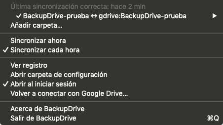
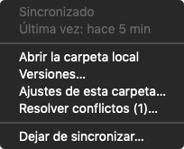
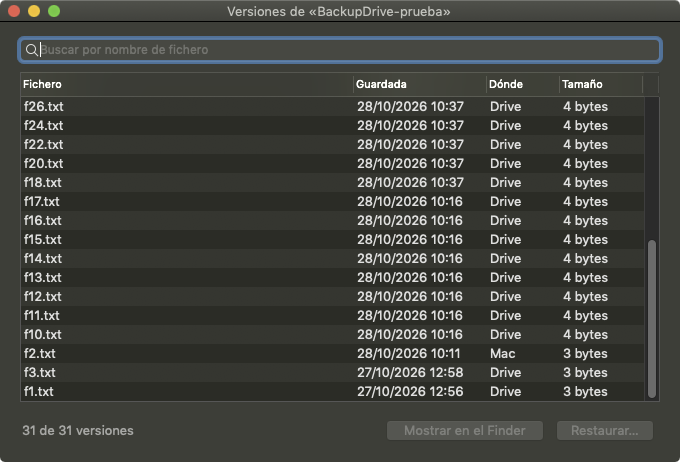
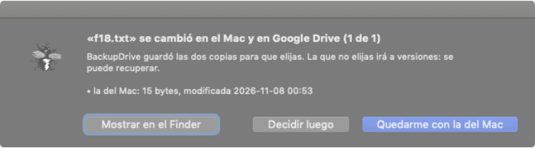

# Pruebas de BackupDrive en la MacPro6,1 (MacTrash, Mojave 10.14.6)

BACKUPDRIVE-LOCAL-1, 07/08 y 14-11-2026, por ssh desde la 7,1. El código es de BACKUPDRIVE-3; aquí solo los resultados.
Rutas con `~` en lugar del usuario. Ni la clave de Google ni datos personales: la clave vive solo en
`~/.config/backupdrive/client_secret.json` (600) de la 7,1 y la 6,1 y en `backupdrive.conf` de la 6,1.

Artefactos `BackupDrive-mojave` probados:
- `37d0e785` (#719, ejecución 41683761099): pruebas 0, 1, h (primera parte) y 7.
- `9b86d0b9` (#851, ejecución 42410434552: secreto por entorno y selftest con 5 columnas): pruebas 3, 4 y 5 (primera vez).
- `b0fba3a9` (#852, #855, #863; ejecución 42427915415): repetición de 0, 5 y 7, y prueba 6 (14-11).

## Resumen

| Prueba | Resultado | Nota |
|---|---|---|
| 0. Instalar artefacto + `mojave-selftest.sh` | Sí | `install.sh` sin sudo (`/usr/local/bin` es del usuario); selftest «sin fallos». Con 37d0e785 avisaba de un remoto «`gdrive:X\|90\|20\|5`»: arreglado en 9b86d0b |
| 1. Clave propia (`connect`) | Sí | Con 9b86d0b el secreto no sale en `ps` (`pgrep -f client_secret=` = 0) y queda una sola línea `client_secret` en el conf (600) |
| h. Sincronización y LaunchAgent | Sí | Pasada a mano 8 s (31 ficheros); pasadas de launchd al cargar y cada hora (`StartInterval` 3600), `status.json` ok |
| 3. Carpeta grande | Sí, lenta | 7 233 ficheros / 734,5 MiB: primera sincronización 1 h 45 min; sin cambios: en seco 263 s, real 462 s |
| 4a. Freno de borrados | Sí | 14 % a la Papelera → `blocked`; devueltos → ok |
| 4b. Freno de modificaciones | Sí, lento | 25,7 % cambiados → `blocked` a los 36 min; Drive intacto |
| 5. Conflictos, versiones, ajustes | **No** | Con b0fba3a `conflicts list` ya ve las copias, pero si quedan copias viejas en Drive bisync numera `conflict2/3` o `conflict3/4`: el lado sale mal o «?» y `keep` se queda con la del Mac cuando se pidió la de Drive (fallo 10) |
| 6. App | Sí, parcial | Menú, submenú de la carpeta, «Versiones…» (31 de 31) y diálogo de conflicto bien; sin AppTranslocation. No hay captura de «Ajustes de esta carpeta…» ni de «Ver qué cambia…» |
| 7. `test-ctl.sh` / `test-sync-safe.sh` con BSD | Sí | b0fba3a: `test-ctl` 111/111 y `test-sync-safe` 58/58, con `/bin/sh` y bash (33 s y 55 s). Con 37d0e785, 98/104 |

## Fallos y observaciones (enviados a BACKUPDRIVE-3)

1. *(Arreglado en #852; comprobado con b0fba3a.)* **`conflicts list` siempre `[]` en macOS** (`backupdrive-ctl.sh`, `conflict_rows`): el `sed` usa `\|` en una ER básica,
   extensión de GNU que el `sed` de BSD no entiende. Consecuencia: la app no enseña conflictos y `conflicts keep` no mueve
   a versiones las otras copias (queda `nombre.conflict1.ext`). Con `sed -E` y `(…|…)` funciona. La CI no lo ve.
2. **Simulación con la carpeta de Drive sin crear:** `--resync --dry-run` falla con «directory not found» y después `plan`
   devuelve todo a cero sin avisar. Con `backupdrive-ctl.sh mkdir` antes, bien (la app ya la crea al añadir).
3. **`plan` viejo tras un bloqueo:** la simulación previa del freno no guarda su plan; tras la 4b, `plan` enseñaba el de la
   4a (borrados), no las modificaciones. «Ver qué cambia» simula de nuevo, así que en la app no engaña; en `plan` sí.
4. **Freno de modificaciones lento:** la simulación tarda lo que tarda en recorrer todas las copias en seco contra Drive
   (~1 fichero/s): 36 min con 1 858 cambiados, aunque el recuento («Path1: N changes … M modified») sale a los 3 min.
5. **Enlaces simbólicos:** no se copian («Can't follow symlink without -L/--copy-links», dos avisos por enlace); solo
   queda en el registro.
6. `profile add` decía «Añadida ~/BackupDrive-prueba ↔ gdrive:BackupDriveGrande» (la carpeta de otro perfil que empieza
   igual); el perfil se guardó bien.
7. El primer `connect` tras `install.sh` falla con «BackupDrive está sincronizando ahora»: `install.sh` recarga el
   LaunchAgent y launchd lanza una pasada al cargarlo.
8. Una pasada de launchd que coincide con otra sale sin escribir nada en el registro (correcto, pero no queda rastro).
9. *(Arreglado en b0fba3a: `xattr` sin `quarantine` y la app corre desde `/Applications`.)* La app se abría desde `AppTranslocation` (cuarentena de la descarga, firma ad hoc).
10. **El lado de una copia en conflicto se deduce del número y bisync no lo garantiza.** rclone numera los sufijos saltándose los
    nombres que ya existen en cualquiera de los dos lados. Si en Drive quedan copias viejas (`f18.conflict1.txt` aún sin
    borrar tras un `keep` y antes de la pasada siguiente), la copia del Mac sale como `conflict2` y la de Drive como
    `conflict3` (registro: «Renaming Path1 copy … f18.conflict2.txt», «Renaming Path2 copy … f18.conflict3.txt»).
    `conflicts list` dice `"side":"drive"` para la del Mac y `"?"` para `conflict3`/`conflict4`; `conflicts keep …
    f18.conflict2.txt` («la de Drive») deja la del Mac. No se pierde nada (lo demás va a versiones), pero se elige mal. Ideas:
    sacar el lado del registro o del plan de esa pasada, o `--conflict-suffix` con nombres por lado.
11. Los arreglos de los fallos 3, 4 y 8 (31205f06, 8090326b) son anteriores a b0fba3a, pero no se repitieron aquí.

## Detalle

**0.** `install.sh` → «LaunchAgent actualizado y activo», app en `/Applications`. `mojave-selftest.sh`: macOS 10.14.6, binario
`rclone v1.67.0-backupdrive` (mínimo 10.13), TLS con Google, hora sin desfase, token válido, launchd cargado.

**1.** `BACKUPDRIVE_CLIENT_SECRET=… backupdrive-ctl.sh connect --client-id …` en segundo plano; el navegador por defecto de
la 6,1 (FlyWeb) abre la autorización; tras autorizar, `{"ok":true,"name":"gdrive",…}` y `check` ok.

**h.** Perfil existente `~/BackupDrive-prueba|gdrive:BackupDrive-prueba|90|20|5` sin `--resync`: rc 0, «No changes found»,
«Bisync successful». launchd: pasadas a las 21:10 y 21:22 (al cargar) y 23:23 (periódica); la de 22:23 coincidió con el
`--resync` de la prueba 3 y se saltó por el bloqueo.

**3.** Copia con `ditto` (sin datos personales) de las Frameworks del SDK de CommandLineTools y de `/Library/Desktop Pictures`:
7 233 ficheros, 840 enlaces, 1 407 carpetas. `--resync --dry-run` 8 s; `plan`: 7 233 nuevos en el Mac. `--resync`: 1 h 45 min
27 s, sin errores ni límites de Google (~1,1 ficheros/s: manda el número de ficheros, no los bytes). Al terminar, perfil
quitado y carpeta borrada en el Mac y en Drive (a la papelera de Drive).

**4a.** `Kernel.framework` (1 025 ficheros) a `~/.Trash` → rc 1, `blocked` (exit 4): «Safety abort: too many deletes (>10%,
1117 of 8639)». Con `--dry-run`, `plan`: 1 117 borrados en el Mac (cuenta carpetas). Devueltos → ok.

**4b.** 1 858 ficheros con una línea añadida → rc 1 en 2 183 s, `blocked`: «Modificaciones masivas en Path1: 1858 de 7233
ficheros cambian de contenido (umbral 20 % y 50)». Drive sin el cambio y sin versiones nuevas. Deshecho con la copia previa
→ ok, «No changes found».

**5.** `f18.txt` editado en el Mac y en Drive (`backupdrive copyto`) → `f18.conflict1.txt` y `f18.conflict2.txt` en los dos
lados; `profile list` cuenta 4 copias, `conflicts list` da `[]`. `conflicts keep … f18.conflict2.txt` deja `f18.txt` con la de
Drive, pero `f18.conflict1.txt` sigue en los dos lados. `versions list` (28, bien), `versions restore … drive
f18-20261028-103748.txt` (bien; lo que había va a versiones del Mac y la pasada siguiente lo sube), `profile set --days 30
--pct 25 --count 6` y vuelta (bien), `--days -1` → código 6 con mensaje.

**7.** `BACKUPDRIVE_BIN=/usr/local/bin/backupdrive`, con `/bin/sh` y `/bin/bash`: `test-sync-safe.sh` 53/53 (34 s);
`test-ctl.sh` falla en «conflicto: copia del Mac/de Drive (salida: [])», «quedan copias en conflicto en el Mac/en Drive»,
«copia del Mac perdida» y «sin freno», todos por el fallo 1.

**5 (b0fba3a, 14-11).** Antes, Titín resolvió en la app un `f18` viejo con «Quedarme con la del Mac» (bien). Después, con
`f4.txt` y `f18.txt` cambiados en el Mac y en Drive y sin una pasada entre medias, bisync dejó `f18.conflict2/3` y
`f4.conflict3/4` (fallo 10). `keep f18.conflict2.txt` (marcada «drive»): `f18.txt` quedó con el contenido del Mac y
el de Drive se fue a versiones. `keep f4.conflict1.txt` → código 6, «Ya no existe…» (correcto). Se deja `f4` sin
resolver (`conflict3` = Mac, `conflict4` = Drive) para reproducirlo.

**6 (b0fba3a, 14-11).** Capturas solo de las ventanas de la app (`screencapture -l`):

 

El diálogo de conflicto solo ofrece «Quedarme con la del Mac» porque la copia de Drive ya no estaba (1 de 1). «Versiones…»
enseña «Cargando…» un momento y luego «31 de 31 versiones». En el submenú de una carpeta al día no aparece «Ver qué
cambia…». La app lleva abierta desde el 12-11 sin informes de cuelgue.
